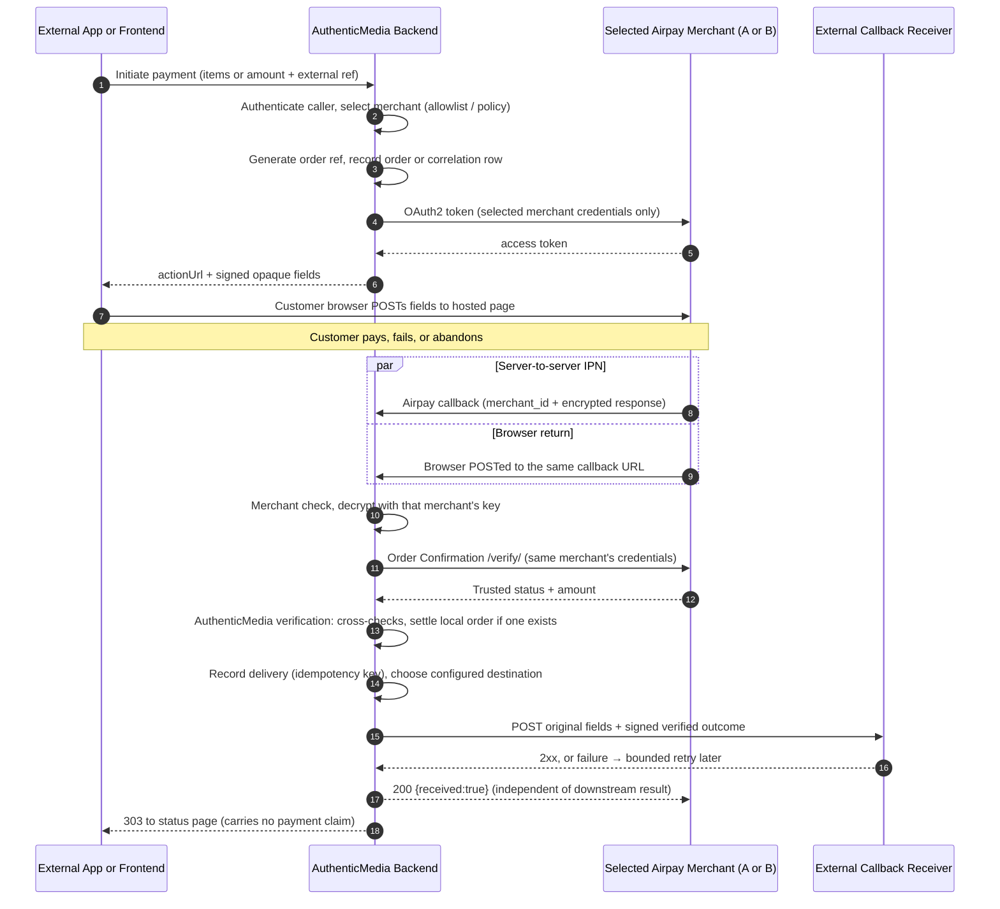

# AuthenticMedia Dual Airpay Integration — Analysis and Implementation Blueprint

**Status:** investigation and design only. No source, migration, deployment setting or environment variable was changed to produce this document.
**Date:** 2026-10-13 · **Repository state:** `main` at `13e6d8c`
**Method:** static reading of the repository. No payment was initiated, no Airpay API was called, no production data was read, and the test suite was **not** run (see §13.4).

**Labels used throughout**

| Label | Meaning |
|---|---|
| **FACT** | Read directly from a file in this repository; a path and line are given. |
| **DOC** | Stated by `docs/AIPAY-DOCS.md` (the project's Airpay source of truth). Items it marks PROVEN were established against the live gateway. |
| **CLAIM** | Stated in a code comment or doc about something outside the repository (for example an Airpay dashboard setting). Not verifiable from here. |
| **ASSUMPTION** | Not established anywhere; must be confirmed before it is relied on. |
| **PROPOSED** | New design in this blueprint. Does not exist yet. |

---

## 1. Executive Summary

**Most of the requested architecture already exists and is deployed.** AuthenticMedia already has two server-held Airpay credential sets, an allowlisted merchant selection at payment initiation, a merchant marker carried in the order reference, one callback receiver serving both merchants, settlement gated solely on Airpay's Order Confirmation API, and a relay that forwards callbacks to an external URL **even when no local order exists**.

What is missing is narrower than the brief implies, and it is concentrated in the *external-order* path:

1. **Forwarded callbacks for unknown orders are not verified with Airpay.** For an order with no local row, `settleOrder` returns `unknown_order` before Order Confirmation is ever called ([settle.ts:101-105](../api/_lib/settle.ts#L101-L105)) and the callback is forwarded anyway ([callback-flow.ts:221-222](../api/_lib/callback-flow.ts#L221-L222)). The receiver gets the callback's own claims, not a verified outcome.
2. **A callback with no encrypted envelope and no stated merchant is forwarded as-is.** Anyone who can POST to the public callback URL can cause a forged `SUCCESS` to be relayed to the external receiver (§11.2, risk R1). This is the most important finding in this document.
3. **Delivery is single-shot.** One attempt, 5 s timeout, no retry, no record, no idempotency key ([relay.ts:94-139](../api/_lib/relay.ts#L94-L139)). A receiver outage loses the notification permanently.
4. **There is no way for an external application to *initiate* a payment through AuthenticMedia.** `POST /api/payments/create` only prices catalogue services for a guest shopper ([create.ts:81-91](../api/payments/create.ts#L81-L91), [create.ts:160-167](../api/payments/create.ts#L160-L167)). External payments reach this system today only because another portal uses the same Airpay MID directly.
5. **The destination is one unvalidated URL shared by both merchants**, the outbound request follows redirects, and the receiver has no way to authenticate that a forward came from AuthenticMedia.
6. **Project documentation contradicts the code in several places**, including which callback URL merchant 2's Airpay dashboard actually registers (§3.6). That one is an operational blocker, not a tidiness issue.

**Proposed solution in one paragraph.** Keep everything that exists. Add a *verify-before-forward* step that asks Airpay's Order Confirmation — using the credentials of the merchant the callback was authenticated against — and forward the original fields plus a signed statement of the verified outcome. Refuse to forward a callback that has neither a decryptable envelope nor a confirming answer from Airpay. Add a small delivery outbox for retries and de-duplication. Only then, if a real consumer needs it, add an authenticated server-to-server initiation endpoint with a minimal correlation record. No local business order is required at any point.

**Does the approach support external orders without a local business order record?** Yes — it already forwards them today, and after Phase 1 it will forward them *verified*.

---

## 2. Existing Codebase Architecture

### 2.1 Frontend — FACT

| Aspect | Finding | Evidence |
|---|---|---|
| Framework | React 19, Vite 8, TypeScript 6, Tailwind 4, React Router 7 | [package.json](../package.json) |
| Structure | Feature folders under `src/features/*`, shared services under `src/services/*` | repository tree |
| Checkout entry | Cart drawer → `useCheckout().pay()` | [use-checkout.ts:122-201](../src/features/cart/hooks/use-checkout.ts#L122-L201) |
| Airpay seam | `createAirpayPayment`, `submitToAirpay`, `fetchOrderStatus` | [airpay-adapter.ts:87-236](../src/services/payment/airpay-adapter.ts#L87-L236) |
| Merchant picker | Two radios, both labelled "Pay with airpay", values `1` and `2` | [checkout-merchant-choice.tsx:28-40](../src/features/cart/components/checkout-merchant-choice.tsx#L28-L40) |
| Success page | Polls `/api/orders/status` every 3 s, up to 20 attempts; reports `unresolved`, never invents `failed` | [use-order-status.ts:17-18](../src/features/cart/hooks/use-order-status.ts#L17-L18) |
| Browser crypto / secrets | None. The browser forwards opaque signed fields verbatim | [airpay-adapter.ts:145-166](../src/services/payment/airpay-adapter.ts#L145-L166) |

Note: `paymentService` is still bound to the mock ([src/services/payment/index.ts](../src/services/payment/index.ts)); the live checkout bypasses that interface and calls `createAirpayPayment` directly.

### 2.2 Backend — FACT

There is no long-running server. The backend is four Vercel Serverless Functions (Node runtime) in `api/`, sharing a library in `api/_lib/`.

| Route (public URL) | File | Purpose |
|---|---|---|
| `POST /api/payments/create` | [api/payments/create.ts](../api/payments/create.ts) | Re-price, insert order, mint token, return signed hosted-page fields |
| `ANY /callback/cpm/arp_frontiva/collection` | [api/callback/cpm/arp_frontiva/collection.ts](../api/callback/cpm/arp_frontiva/collection.ts) | Airpay Response URL **and** IPN URL, both merchants |
| `GET /api/orders/:ref?t=` | [api/orders/status.ts](../api/orders/status.ts) | Token-gated status; settles inline if unsettled |
| `GET\|POST /api/payments/reconcile` | [api/payments/reconcile.ts](../api/payments/reconcile.ts) | Bearer-gated cron sweep of unsettled local orders |

Library modules: `config.ts` (credentials, merchant allowlist), `airpay-crypto.ts` (all protocol primitives), `airpay.ts` (OAuth + Order Confirmation client), `callback-payload.ts` (body decode, merchant check, envelope open), `callback-flow.ts` (parse → settle → relay), `settle.ts` (the single `settleOrder`), `relay.ts` (external forward), `order-ref.ts`, `db.ts`, `walk.ts`, `http.ts`, `log.ts`, `contact.ts`.

### 2.3 Hosting and deployment — FACT

- **Vercel.** [vercel.json](../vercel.json) defines the build, rewrites, function limits and cron; `.vercel/project.json` links project `authentic-media`.
- Rewrites ([vercel.json:5-16](../vercel.json#L5-L16)): `/api/orders/:ref` → status function; `/callback/cpm/arp_frontiva/collection` (with and without trailing slash) → the callback function; then the SPA catch-all. The callback rewrites sit above the catch-all, which is required.
- All four functions have `maxDuration: 10` ([vercel.json:17-22](../vercel.json#L17-L22)).
- One cron: `/api/payments/reconcile` daily at 03:00 UTC ([vercel.json:23-28](../vercel.json#L23-L28)).
- `.vercelignore` excludes `*.test.ts(x)` so tests are not deployed as functions.

### 2.4 Database and external services — FACT

- **Supabase (Postgres).** Server functions use the service-role key ([db.ts:15-30](../api/_lib/db.ts#L15-L30)); the browser uses the anon key.
- Tables referenced by server code: `orders`, `order_items`, `payments`, `services`. The base `create table` statements are **not** in `supabase/migrations/`; the only schema migration there is additive ([20260831_airpay_settlement.sql](../supabase/migrations/20260831_airpay_settlement.sql)).
- Three `SECURITY DEFINER` RPCs, execution revoked from `public/anon/authenticated`: `create_airpay_order`, `settle_airpay_order`, `cancel_airpay_order` ([migration:96-264](../supabase/migrations/20260831_airpay_settlement.sql#L96-L264)).
- **Airpay v4** endpoints are constants ([config.ts:69-71](../api/_lib/config.ts#L69-L71)): OAuth, Order Confirmation (`/verify/`), hosted page.
- **KKChat** is the only external callback receiver ([relay.ts:29](../api/_lib/relay.ts#L29)).

### 2.5 Environment, logging, errors, tests — FACT

- Secrets are read from `process.env` at call time; a missing value throws `ConfigError` naming the variable, never its value ([config.ts:50-55](../api/_lib/config.ts#L50-L55)). No Airpay variable carries a `VITE_` prefix. `.env` and `.env.*` are git-ignored.
- Logging is one function emitting a JSON line ([log.ts](../api/_lib/log.ts)); call sites log names and categories, not values.
- Error handling is fail-closed and non-throwing on the public path: the parser never throws, verification returns `null` for anything inconclusive, machines always get `2xx`.
- Tests: Vitest, Node environment, `api/**/*.test.ts` and `src/**/*.test.{ts,tsx}` ([vitest.config.ts](../vitest.config.ts)). 17 test files exist under `api/` alone, covering crypto, callback decoding, multi-merchant routing, forwarding, settlement, and reconciliation.

---

## 3. Current Airpay Integration Findings

### 3.1 Two merchants are already configured — FACT

| Logical account (brief) | Code identity | Env suffix | Order-ref prefix | MID noted in code comments |
|---|---|---|---|---|
| Airpay Account A | `MerchantId = 1` | none (original names) | `AM-` | 368250 |
| Airpay Account B | `MerchantId = 2` | `_2` | `AM2-` | 362380 |

- Type and loader: [config.ts:25](../api/_lib/config.ts#L25), [config.ts:107-128](../api/_lib/config.ts#L107-L128). Six credentials per merchant; `AIRPAY_ENV` and `AIRPAY_VERIFY_URL` are shared.
- OAuth token cache is keyed by merchant, so a token cannot cross accounts ([airpay.ts:78](../api/_lib/airpay.ts#L78), [airpay.ts:100](../api/_lib/airpay.ts#L100)).
- All crypto primitives take the merchant's config as a parameter ([airpay-crypto.ts](../api/_lib/airpay-crypto.ts)); there is no global "active merchant".

### 3.2 Merchant selection at initiation — FACT

- The browser sends `merchant: 1 | 2`. The server accepts exactly `1`, `2`, `"1"`, `"2"` and rejects everything else with a 400; there is no default ([config.ts:151-155](../api/_lib/config.ts#L151-L155), [create.ts:126-131](../api/payments/create.ts#L126-L131)).
- No MID, credential, URL or order reference is read from the request body.
- The server generates the order reference from a CSPRNG with the merchant's prefix ([order-ref.ts:30-36](../api/_lib/order-ref.ts#L30-L36), [create.ts:149](../api/payments/create.ts#L149)).
- **Selection is by the shopper, not by server policy.** This is a deliberate, tested design choice ([config.ts:10-15](../api/_lib/config.ts#L10-L15)). It is safe in the sense that the client can only pick between two server-defined accounts; it is *not* "server-authorized routing" in the sense §3 of the brief describes.

### 3.3 Merchant recovery after initiation — FACT

- For local orders the merchant is decoded from the reference prefix: anything not starting `AM2-` is merchant 1 ([order-ref.ts:56-58](../api/_lib/order-ref.ts#L56-L58)). Settlement, the status poll and the cron sweep all use it ([settle.ts:97-98](../api/_lib/settle.ts#L97-L98)).
- For inbound callbacks the merchant is resolved by the parser: a stated `merchant_id` is compared with each configured MID from the server's own environment; if none is stated, each accepted merchant's key is tried and only one that actually decrypts the envelope is accepted ([callback-payload.ts:306-347](../api/_lib/callback-payload.ts#L306-L347), [callback-payload.ts:354-383](../api/_lib/callback-payload.ts#L354-L383)).
- **Gap:** the parser does not *return* which merchant it resolved. `CallbackParse` has no merchant field ([callback-payload.ts:42-64](../api/_lib/callback-payload.ts#L42-L64)). Any later step that needs the right credentials for an external order has nothing to go on except the reference prefix, which is wrong for an external reference on merchant 2.

### 3.4 Payment request construction — FACT, matches DOC §7

Payload sent to Airpay ([create.ts:206-220](../api/payments/create.ts#L206-L220)): `orderid`, `amount` (two decimals), `currency_code: "356"`, `iso_currency: "inr"`, `buyer_email`, `buyer_phone`, `buyer_firstname`, `buyer_lastname`. Envelope: `merchant_id`, `encdata`, `checksum`, `privatekey`. The amount comes only from `services.price_inr` inside `create_airpay_order` ([migration:224-227](../supabase/migrations/20260831_airpay_settlement.sql#L224-L227)). **There is no return-URL or callback-URL field**; DOC §8.1 (PROVEN) states Airpay resolves both per MID from its dashboard.

### 3.5 Callback, settlement and relay as built — FACT

Pipeline: `parse → settle → relay → reply` ([callback-flow.ts:104-239](../api/_lib/callback-flow.ts#L104-L239)).

| Step | Behaviour | Evidence |
|---|---|---|
| Body | Drains unparsed streams (512 KB cap); JSON → multipart → urlencoded | [callback-payload.ts:76-177](../api/_lib/callback-payload.ts#L76-L177) |
| Merchant check | Before decryption; a MID matching neither merchant stops the read | [callback-payload.ts:337-347](../api/_lib/callback-payload.ts#L337-L347) |
| Envelope | AES-256-CBC; `+`→space repair only after a first failure; plaintext **replaces** outer fields; unreadable envelope ends the read | [callback-payload.ts:350-424](../api/_lib/callback-payload.ts#L350-L424) |
| No envelope | Outer fields are used as the effective fields | [callback-payload.ts:352](../api/_lib/callback-payload.ts#L352), [:441-446](../api/_lib/callback-payload.ts#L441-L446) |
| Settle | Load order → terminal short-circuit → legacy guard → CRC32 check (reject-only) → live-MID guard → Order Confirmation → status/amount rules → conditional UPDATE | [settle.ts:75-278](../api/_lib/settle.ts#L75-L278) |
| Unknown order | Returns `unknown_order`; **no Order Confirmation call** | [settle.ts:101-105](../api/_lib/settle.ts#L101-L105) |
| Relay | Runs after settle, **regardless of outcome**; same destination for both merchants | [callback-flow.ts:221-228](../api/_lib/callback-flow.ts#L221-L228) |
| Relay transport | `POST` JSON object of the opened fields, original casing; 64 fields / 1024 chars; 5 s timeout; never throws; no retry | [relay.ts:94-139](../api/_lib/relay.ts#L94-L139) |
| Reply | Browser → `303` to `/order-success`; machine → `200 {received, outcome}` always | [callback-flow.ts:231-238](../api/_lib/callback-flow.ts#L231-L238) |

Recovery paths for **local** orders: success-page poll ([status.ts:72-80](../api/orders/status.ts#L72-L80)) and the daily sweep ([reconcile.ts:60-88](../api/payments/reconcile.ts#L60-L88)). **Neither covers external orders**, because both start from a local row.

### 3.6 Contradictions found between documents and code — FACT

These must be reconciled before implementation, because several describe live gateway configuration.

| # | Statement A | Statement B | Why it matters |
|---|---|---|---|
| C1 | Merchant 2's dashboard points at KKChat, so Airpay never returns that browser; `returnsToSite: merchant === 1` and a separate-window + polling flow — [create.ts:232-244](../api/payments/create.ts#L232-L244), [use-checkout.ts:68-82](../src/features/cart/hooks/use-checkout.ts#L68-L82) | Merchant 2 "now registers THIS URL in its own Airpay dashboard" — [callback-flow.ts:114-117](../api/_lib/callback-flow.ts#L114-L117), [collection.ts:32-35](../api/callback/cpm/arp_frontiva/collection.ts#L32-L35) | Only one is true. If B, the popup flow is unnecessary and the paying window lands on `/order-success` inside a popup. If A, AuthenticMedia never receives merchant-2 callbacks and the relay for merchant 2 never fires. **Blocker B1.** |
| C2 | "Merchant 2's callbacks are NOT relayed from here" — [.env.example:100-105](../.env.example#L100-L105) | Both merchants are relayed — [callback-flow.ts:201-207](../api/_lib/callback-flow.ts#L201-L207) | `.env.example` is stale. |
| C3 | Second merchant "removed… one merchant, one callback URL" — DOC §14.3 | Two merchants live in code since `ae392fc` | The source-of-truth doc predates the restore. 19 source files cite a "§2.4" that does not exist in `docs/AIPAY-DOCS.md`. |
| C4 | "This repository has no `api/` directory and no server runtime" — CLAUDE.md §29.2, AGENTS.md §30.1, §30.11 | `api/` exists with four routes | Agent guidance is stale. |
| C5 | Required routes include `/api/payments/callback` and `/api/payments/return` — AGENTS.md §30.7, DOC §8.1 | Neither file exists here | Only the dashboard-registered path is implemented. |
| C6 | "Airpay delivers callbacks to KKChat rather than to us" — [airpay.ts:226-227](../api/_lib/airpay.ts#L226-L227) | The callback route receives them | Stale comment. |
| C7 | Local `.env` holds merchant-1 values under `CLIENT_ID`, `USERNAME`, `PASSWORD`, `API_KEY`, `SECRET_KEY` (names only inspected) | Code reads `AIRPAY_CLIENT_ID`, `AIRPAY_USERNAME`, … | Merchant 1 cannot load from the local file. Production values live in Vercel and were not inspected. |

---

## 4. Frontiva Reference Analysis

### 4.1 Availability — FACT

**The Frontiva source code is not available.** No repository named Frontiva exists in the workspace or alongside it. `claude/frontiva-ai-bridge` on this machine is an unrelated WordPress plugin with no Airpay code. No remote was fetched.

What *is* available is the **Yarnvia** project (`../new_shop`, remote `vishnuweb-a/nycom`), whose `api/_lib/{airpay,callbackPayload,callbackFlow,settle,relay}.ts` are exactly the "reference implementation" files named at the top of `docs/AIPAY-DOCS.md`. It is the lineage this repository was ported from, and its relay targets the `arp_frontiva` KKChat path. It was read for comparison. **It is not Frontiva**, and nothing below should be read as a statement about Frontiva's running code.

### 4.2 Confirmed from the Yarnvia reference — FACT (about `../new_shop`)

| Question in the brief | Finding |
|---|---|
| Credentials | Single merchant; same six variables and the same PROVEN secret-role swap |
| Merchant choice | None — one merchant |
| Callback URLs | Dashboard path `/callback/cpm/arp/collection` rewritten above the SPA catch-all, plus `/api/payments/callback` (relays) and `/api/payments/return` (does not relay), all over one pipeline |
| Authenticity | Order Confirmation only; callback is a trigger |
| Forwarding | `forwardCallback(fields, orderRef)` after settlement, awaited, 5 s timeout, never throws |
| Local record required to forward? | **No.** The relay runs for every parsed callback; a test asserts "forwards an unverifiable callback too, without settling it" |
| Unrecognised order reference | `unknown_order`, logged; still relayed |
| Failed forwarding | Logged (`forward.rejected` / `forward.failed`); **no retry, no persistence** |
| Duplicate protection | Settlement only (conditional UPDATE). **None on the relay** — each delivery, and each leg, forwards again |
| Serverless behaviour | Vercel; relay awaited so the instance is not frozen mid-request; timeouts below the function ceiling |

### 4.3 Reference URLs supplied in the brief — CLAIM / ASSUMPTION

| URL | Status |
|---|---|
| `https://frontiva.online/callback/cpm/arp/collection` | ASSUMPTION — matches the Yarnvia path shape; not verifiable here |
| `/api/payments/callback`, `/api/payments/return` | Consistent with the Yarnvia reference; **not present in AuthenticMedia** |
| `https://kkchat.in/callback/cpm/arp_frontiva/collection` | FACT that it is AuthenticMedia's current default destination ([relay.ts:29](../api/_lib/relay.ts#L29)). DOC §13.2 (PROVEN) warns this host answers `200 "success"` to any middle path segment, so a 200 is not proof of delivery |

### 4.4 What to take from the reference, and what not to

- **Take:** the one-pipeline rule, verify-by-pull, relay-after-settle, await-on-serverless, 2xx-to-machines. AuthenticMedia already has all of them.
- **Do not copy:** forward-without-verification and single-shot delivery. Both are inherited weaknesses, and they are precisely the two gaps this blueprint closes.
- **Do not reuse:** Frontiva's or Yarnvia's destination path for a new client without that client confirming the exact segment (DOC §13.2).

---

## 5. Dual Airpay Merchant Architecture

### 5.1 Reuse, do not replace

The existing `MerchantId = 1 | 2` model satisfies the two-configuration requirement. **Do not introduce `airpay_a` / `airpay_b` identifiers in code**; renaming would touch live environment variables and order-reference prefixes that existing rows depend on ([order-ref.ts:21-28](../api/_lib/order-ref.ts#L21-L28)). Where an external API needs a readable name, map it at the edge: `airpay_a → 1`, `airpay_b → 2`.

### 5.2 Credential fields per merchant — FACT + DOC §2

| Field | Role |
|---|---|
| `mid` | Merchant ID, sent in the clear |
| `clientId` | OAuth2 `client_id` |
| `secretKey` | OAuth2 `client_secret` (PROVEN: not the API key) |
| `apiKey` | Secret in the `privatekey` derivation |
| `username` | AES key derivation, `privatekey`, `ap_SecureHash` |
| `password` | AES key derivation, `privatekey` |

Derived per merchant, never stored: `privatekey`, AES key. There is no separate "verification key" — callbacks are decrypted with the same AES key, and truth comes from Order Confirmation.

### 5.3 Selection mechanism

| Initiator | Mechanism | Status |
|---|---|---|
| AuthenticMedia checkout (browser) | Shopper picks index `1\|2`; server allowlists it; no default | **Exists.** Keep. |
| External application (server-to-server) | **PROPOSED:** merchant chosen by server policy for the authenticated client: a per-client allowed set and default. A request may name a merchant only from its allowed set | New — Phase 4 |
| Random / load-balanced | Not implemented and not recommended; no business requirement exists | — |

Optional hardening for the browser path, **only if the business does not actually want shoppers choosing**: a server-side `CHECKOUT_ALLOWED_MERCHANTS` allowlist applied inside `parseMerchantSelection`'s caller. This would contradict the documented "no global switch" intent ([config.ts:10-15](../api/_lib/config.ts#L10-L15)), so it is a product decision (question Q7), not a default recommendation.

### 5.4 Recovering the merchant when the callback arrives

Order of trust, strongest first:

1. **The key that decrypts the envelope.** Cryptographic; cannot be asserted by the sender. Already implemented.
2. **A stated `merchant_id` equal to a server-configured MID**, which only narrows which key is tried. Already implemented.
3. **The server-issued order-reference prefix** (`AM-`, `AM2-`, and PROPOSED `AX-`, `AX2-` for externally initiated payments). Valid only for references this server generated.
4. **A correlation record** (PROPOSED, Phase 4) keyed by the server-generated reference.

Never: a merchant named in an unauthenticated callback field with no envelope, or anything in the browser.

**PROPOSED change:** `parseCallback` returns `merchant: MerchantId | null` — the merchant whose key opened the envelope, or the one whose MID matched, or `null` when neither happened.

### 5.5 Auditability

`payment.initiated` already logs `orderRef` and `merchant` ([create.ts:187-192](../api/payments/create.ts#L187-L192)). PROPOSED additions: `merchant` on `payment.callback.received` and on every forward event; `clientId` on externally initiated payments.

---

## 6. Complete Payment Lifecycle

### 6.1 Three origins of a payment

| Origin | Who creates the Airpay order | Local record today | Supported today |
|---|---|---|---|
| **O1** AuthenticMedia checkout | `POST /api/payments/create` | Full `orders` row | Yes, end to end |
| **O2** Third party directly on a shared MID | The other portal, straight to Airpay | None | Callback is received and forwarded **unverified** |
| **O3** External app via AuthenticMedia | PROPOSED `POST /api/payments/external/create` | PROPOSED minimal correlation row | No |

### 6.2 Step by step

**A. Initiate.** O1 as built. O3 (PROPOSED): an authenticated server-to-server request carrying `amount`, `currency`, `externalOrderRef`, buyer contact and optionally a merchant name.

Trust boundary for fields:

| Field | O1 (browser) | O3 (authenticated server) |
|---|---|---|
| Amount | **Server only** (catalogue) | Client-supplied; authenticated; bounded by per-client min/max; recorded |
| Currency | Server constant INR | Must equal `INR`; anything else rejected (only `356/inr` is documented) |
| Airpay `orderid` | **Server-generated** | **Server-generated** (`AX-`/`AX2-`); the external reference is stored beside it, not sent as `orderid` |
| Merchant | Allowlisted index | Server policy per client |
| Callback destination | Server config | **Server config per client — never in the request** |
| Return URL | Server config | Server config per client |
| Credentials, MID, verify URL | Never accepted | Never accepted |

**B. Select merchant.** Per §5.3. Load exactly one config with `loadAirpayConfig(merchant)`; a missing credential fails closed with no fallback to the other set (already tested).

**C. Create payment.** Record first, then mint the token, then build and sign (existing order of operations, [create.ts:160-220](../api/payments/create.ts#L160-L220)). Response: `actionUrl` + four opaque fields.

**D. Customer pays** on Airpay's hosted page. Outcomes and how each is learned:

| Outcome | Signal | Resulting state |
|---|---|---|
| Success | Callback → Order Confirmation `200` | `paid` / forwarded `success` |
| Failed | Callback → Order Confirmation `400` | `failed` / forwarded `failed` |
| Pending (UPI) | Order Confirmation `211` | stays `pending`; re-checked later |
| Cancelled / abandoned | Usually no callback at all | stays `pending`; expires out of the sweep window |
| Unknown / unreadable | `null`, missing or undocumented status | `pending` — never `failed` (DOC §10.4, PROVEN) |
| Wrong amount | Confirmed amount ≠ expected | `requires_review` |

**E. Receive callback.** Parse and authenticate as built; resolve the merchant per §5.4.

**F. Verify, then forward.** PROPOSED: for orders with no local row, call Order Confirmation with the resolved merchant's credentials, then forward (§8.4).

**G. Retries and duplicates.** PROPOSED: deterministic delivery id, outbox row, bounded retries (§11.4).

### 6.3 Sequence diagram



---

## 7. External Orders Without Local Database Dependency

### 7.1 Three concepts, kept separate

| Concept | Owner | What AuthenticMedia needs |
|---|---|---|
| **Order storage** | The originating application | Nothing. No row in `orders` is required. |
| **Payment verification** | Airpay, queried by AuthenticMedia | The order reference and the right merchant's credentials |
| **Callback delivery** | AuthenticMedia | A server-configured destination and, for reliability, a delivery record |

### 7.2 What already works — FACT

A callback for a reference with no local row is parsed, settles to `unknown_order` with no database write, and is forwarded. Tests assert this for both merchants and for non-`AM-` reference formats ([callback-forwarding.test.ts:253-311](../api/callback-forwarding.test.ts#L253-L311), [multi-merchant-flow.test.ts:654-723](../api/multi-merchant-flow.test.ts#L654-L723)). **A missing local order does not cause a callback to be discarded.**

### 7.3 What is missing

Verification. The forward carries the callback's own claims.

### 7.4 Why Order Confirmation makes a stateless design possible

Order Confirmation is keyed on `orderid` and merchant only ([airpay.ts:244](../api/_lib/airpay.ts#L244)) — no amount, no Airpay transaction id, no prior state. Given an order reference and the merchant, AuthenticMedia can ask Airpay what happened to a payment it has never heard of. That is "missing local order with valid gateway proof".

**PROPOSED function** `confirmForRelay(orderRef, merchant)` → wraps the existing `verifyTransaction`. It reads nothing from and writes nothing to the database, and it is **not a settlement path**: it never marks anything paid. `settleOrder` remains the only function that changes an order.

The merchant must come from the parser (§5.4), **not** from `merchantForOrderRef`: an external reference on merchant 2 has no `AM2-` prefix and would be asked of merchant 1.

### 7.5 Is a fully stateless design realistic?

| Capability | Stateless (O2 path) | Needs a small record |
|---|---|---|
| Authenticate the callback's origin | Yes — envelope key | — |
| Establish the true status | Yes — Order Confirmation | — |
| Establish the amount actually paid | Yes — Order Confirmation | — |
| Check amount against the **expected** amount | **No.** AuthenticMedia never knew it. The receiver must compare against its own order | Yes, if AuthenticMedia initiated (O3) |
| Identify the merchant | Yes — envelope key / MID | — |
| Route to the right receiver | Only if routing is per merchant or per reference prefix | Yes, for per-client routing |
| Preserve the external reference | Yes — in O2 it *is* the Airpay `orderid` | Yes, in O3 (mapped from the server-generated ref) |
| De-duplicate deliveries | Only by giving the receiver a deterministic idempotency key | Yes, to suppress duplicates at source |
| Retry after a receiver outage | Only within the same request (seconds) | Yes |
| Recover when Airpay never calls back | **No.** Nothing exists to sweep | Yes, for O3 |
| Hold a callback until Airpay answers | **No** | Yes |

**Conclusion.** Verification can be stateless. Reliable delivery cannot. The minimum durable state is a **delivery outbox**, not an order table.

### 7.6 Minimum state — PROPOSED

`airpay_callback_deliveries` (service role only, RLS enabled with no policies, like the rest of the payment tables):

| Column | Purpose |
|---|---|
| `delivery_id` (PK) | `sha256(merchant ‖ order_ref ‖ ap_transaction_id ‖ verified_status)` — the idempotency key |
| `merchant` | `1 \| 2` |
| `order_ref` | Airpay `orderid` as received |
| `verified_status` | `success \| failed \| pending \| unconfirmed` |
| `verified_amount` | From Order Confirmation; null if unconfirmed |
| `destination_key` | Name of a configured destination — never a URL |
| `payload` | The bounded fields to send |
| `state`, `attempts`, `next_attempt_at`, `last_http_status` | Delivery bookkeeping |
| `created_at`, `delivered_at` | Audit; rows purged a fixed period after delivery |

For O3 only, `external_payment_intents`: `order_ref` (PK, server-generated), `client_id`, `merchant`, `external_order_ref`, `amount_inr`, `status`, `created_at`. This is a correlation record — no items, no customer profile, no business state.

> **Tension to approve (Q9).** DOC §17 says "Do not mirror Airpay's transaction data". The outbox `payload` holds callback fields (which include a customer's phone, email or VPA) for the retry window. It is a transient queue with a purge, not a second source of truth, but it is a departure that needs sign-off. The alternative — store only the reference and rebuild the payload from Order Confirmation at retry time — depends on Q4.

### 7.7 Validations that remain mandatory without owning the order

1. Merchant resolved from server-held configuration only.
2. An envelope, when present, must decrypt under an accepted merchant's key; otherwise the delivery is rejected and not forwarded (exists).
3. Order Confirmation under that merchant, with all existing cross-checks: inner `success` flag, echoed `orderid`, echoed `merchant_id`, status present, no status conflict ([airpay.ts:292-335](../api/_lib/airpay.ts#L292-L335)).
4. Status taken from the confirmation, never from the callback.
5. Amount taken from the confirmation; a callback amount that disagrees is flagged.
6. Destination chosen from server configuration.
7. A deterministic idempotency key on every forward.
8. A delivery with neither a decryptable envelope nor a confirming answer is **not forwarded**.

---

## 8. Callback Architecture

### 8.1 Endpoints — confirmed versus proposed

| Endpoint | Kind | Status |
|---|---|---|
| `https://authenticmedia.fun/callback/cpm/arp_frontiva/collection` | Gateway-facing; Response URL **and** IPN URL | **Confirmed** in code and rewrites. CLAIM that both MIDs register it (see C1) |
| `/api/callback/cpm/arp_frontiva/collection` | Internal function behind the rewrite | **Confirmed** |
| `GET /api/orders/:ref?t=` → `/api/orders/status` | Status for local orders | **Confirmed** |
| `GET\|POST /api/payments/reconcile` | Cron sweep | **Confirmed** |
| `POST /api/payments/create` | Checkout initiation | **Confirmed** |
| `/api/payments/callback`, `/api/payments/return` | Transport adapters | **Do not exist here.** Not needed unless a MID is repointed |
| `https://kkchat.in/callback/cpm/arp_frontiva/collection` | External receiver | **Confirmed** as the default; path segment per DOC §13.2 |
| `POST /api/payments/external/create` | Authenticated external initiation | **PROPOSED** (Phase 4) |
| `GET /api/payments/external/status` | Authenticated enquiry for an external reference | **PROPOSED**, optional (Phase 4) |
| Outbox drain inside `/api/payments/reconcile` | Retry worker | **PROPOSED** (Phase 2) |

### 8.2 Unified endpoint or one per merchant?

**Recommendation: keep the unified endpoint.**

- The gateway-facing URL is set in each MID's Airpay dashboard, which the application does not control (DOC §8.1). The application must answer whatever is registered.
- The unified receiver is already safe: a stated MID only narrows the candidate set, and the ciphertext decides.
- Merchant-pinned URLs are already supported by the pipeline (`options.merchant`, [callback-flow.ts:107](../api/_lib/callback-flow.ts#L107), [:124-125](../api/_lib/callback-flow.ts#L124-L125)). If a dashboard is ever repointed, adding a pinned route is one file plus one rewrite, with no pipeline change. Pinning is marginally stricter (the route, not the payload, names the merchant) and worth doing *if* a dashboard change is happening anyway.

### 8.3 Browser return

- Same URL as the IPN; classified by `Sec-Fetch-Dest`, falling back to `Accept` ([callback-payload.ts:489-493](../api/_lib/callback-payload.ts#L489-L493)). Classification changes only the reply shape.
- The `303` carries the order reference and a server-looked-up read token, never a payment claim ([callback-flow.ts:68-87](../api/_lib/callback-flow.ts#L68-L87)).
- **Gap for external orders:** an unknown reference redirects the customer to `authenticmedia.fun/order-success?ref=…&status=unknown` ([callback-flow.ts:82-84](../api/_lib/callback-flow.ts#L82-L84)). A customer of another portal lands on AuthenticMedia's site. PROPOSED: a server-configured return URL per destination, used when no local order exists, carrying only the reference.

### 8.4 Verification and forwarding — PROPOSED pipeline

```
parse ─► settle (local order, unchanged) ─► confirm-for-relay (no local order) ─► decide ─► deliver ─► reply
```

Decision table:

| Envelope | Order Confirmation | Action |
|---|---|---|
| Decrypted | Definite (`200`/`400`/`211`) | Forward, `verified_status` = success / failed / pending |
| Decrypted | Inconclusive | Forward as `unconfirmed` **or** hold in the outbox and re-verify — policy choice Q6; recommended: hold when the outbox exists, forward-flagged before it does |
| Absent | Definite under an accepted merchant | Forward with the verified status |
| Absent | Inconclusive | **Do not forward.** Log `payment.callback.forward.withheld`. This closes R1 |
| Unreadable, or MID mismatch | — | Rejected at parse; never forwarded (exists) |
| Local order exists | Result of `settleOrder` | Forward with the settled outcome; no second Airpay call |

When no envelope is present and no MID is stated, the merchant is unknown; ask Order Confirmation of each accepted merchant **in parallel** and accept the one that returns a record for that reference.

### 8.5 What to forward: original, normalised, or both?

**Both, without changing the existing body.**

- **Body:** unchanged — the original Airpay fields as a single JSON object, original casing, string values (DOC §13.1). The current receiver was built against this shape and DOC §13 warns against altering it.
- **Headers (new, ignorable by an unaware receiver):**

| Header | Content |
|---|---|
| `X-AM-Delivery-Id` | The idempotency key |
| `X-AM-Merchant` | `1` or `2` |
| `X-AM-Verified-Status` | `success \| failed \| pending \| unconfirmed` |
| `X-AM-Verified-Amount` | Amount from Order Confirmation |
| `X-AM-Timestamp` | Unix seconds |
| `X-AM-Signature` | `HMAC-SHA256(secret, timestamp + "." + delivery_id + "." + verified_status + "." + verified_amount + "." + sha256(body))` |

- **Receiver obligations:** verify the signature and reject stale timestamps; act on `X-AM-Verified-Status`, not on `TRANSACTIONSTATUS` in the body; de-duplicate on `X-AM-Delivery-Id`; compare the verified amount with its own order; treat `pending`/`unconfirmed` as non-final.
- A receiver that prefers one structured document can be given an opt-in body format later (`{ "verified": {...}, "airpay": {...} }`), selected per destination in server config.

### 8.6 Status model

| Airpay Order Confirmation | Local order status | Forwarded `verified_status` |
|---|---|---|
| `200` + amount matches | `paid` | `success` |
| `200` + amount differs from expected | `requires_review` | `success` with the verified amount (external: receiver compares) |
| `400` | `failed` | `failed` |
| `211` | `pending_payment` | `pending` |
| none / undocumented / unreachable | `pending_payment` | `unconfirmed` or withheld (§8.4) |
| no callback, shopper left | `pending_payment` → ages out; `cancelled` only via `cancel_airpay_order` | nothing sent |

### 8.7 Acknowledgement is separate from delivery

Airpay always gets `200` once the body has been read, whatever happens downstream (exists; DOC §8.3). The downstream result is recorded in the outbox and the logs, never in the reply to Airpay.

---

## 9. Required File-by-File Changes

Minimum set. Nothing here touches pricing, checkout UI, crypto primitives or `settleOrder`'s decision rules.

### Phase 1 — verified forwarding (no schema change)

| File | Existing responsibility | Required modification | Reason | Depends on | Security consideration | Behaviour after |
|---|---|---|---|---|---|---|
| [api/_lib/callback-payload.ts](../api/_lib/callback-payload.ts) | Decode, merchant check, open envelope | Add `merchant: MerchantId \| null` to `CallbackParse`; set it from the MID match or the key that decrypted | Later steps need the right credentials | — | Must be set only from server-held config or a successful decrypt | Parser reports which merchant authenticated the delivery |
| [api/_lib/callback-flow.ts](../api/_lib/callback-flow.ts) | parse → settle → relay → reply | After `settleOrder` returns `unknown_order`, call `confirmForRelay`; apply the §8.4 decision table; pass outcome and merchant to the relay | Close the unverified-forward gap and R1 | parser change | No new settlement path; no DB write | External callbacks are forwarded verified, or withheld |
| `api/_lib/confirm.ts` (**new**) | — | `confirmForRelay(orderRef, merchant \| null)` wrapping `verifyTransaction`; parallel ask when merchant is null; returns a normalised status | Keeps the flow file small; one place for the status mapping | [airpay.ts](../api/_lib/airpay.ts) unchanged | Never throws; `null` = inconclusive | Trusted outcome for a reference with no local row |
| [api/_lib/relay.ts](../api/_lib/relay.ts) | Single POST to one URL | Accept `{ merchant, deliveryId, verifiedStatus, verifiedAmount }`; add signed headers; `redirect: 'manual'`; validate destination (https, host allowlist); resolve destination per merchant | Receiver authentication, SSRF hardening, per-merchant routing | env additions | Signing secret server-only; body unchanged | Same body, authenticated and idempotent |
| [vercel.json](../vercel.json) | Function limits | Raise `maxDuration` for the callback function (value subject to plan, Q10) | Worst case today is OAuth 8 s + verify 8 s + relay 5 s against a 10 s ceiling ([airpay.ts:18](../api/_lib/airpay.ts#L18), [relay.ts:50](../api/_lib/relay.ts#L50)) — the relay can be killed mid-flight with no log | — | Keep each individual timeout below the ceiling | Relay no longer starved by a slow gateway |
| [.env.example](../.env.example) | Variable documentation | Add new names; fix stale merchant-2 note (C2) | Accuracy | — | Placeholders only | — |
| `api/callback-forwarding.test.ts`, `api/multi-merchant-flow.test.ts` | Forwarding tests | Update the two envelope-less cases to require confirmation; add cases from §13 | Behaviour change is deliberate and must be pinned | — | Mock `fetch`; never the live MID | — |

### Phase 2 — reliable delivery

| File | Existing responsibility | Required modification | Reason | Depends on | Security consideration | Behaviour after |
|---|---|---|---|---|---|---|
| `supabase/migrations/<date>_airpay_callback_deliveries.sql` (**new**) | — | Table from §7.6; RLS on, no policies; enqueue RPC with `on conflict (delivery_id) do nothing` | Durable retry and de-duplication | Approval of Q9 | Service role only; purge job | Duplicate callbacks collapse to one delivery |
| `api/_lib/outbox.ts` (**new**) | — | `enqueueDelivery`, `claimDue`, `markDelivered`, `markFailed` with backoff | Retry bookkeeping | migration | Claim must be a conditional UPDATE (same pattern as `settle_airpay_order`) | At-least-once delivery |
| [api/_lib/callback-flow.ts](../api/_lib/callback-flow.ts) | Pipeline | Enqueue, then attempt once inline; leave the row pending on failure | Fast path stays fast | outbox | Airpay still gets 200 | Receiver outage no longer loses a notification |
| [api/payments/reconcile.ts](../api/payments/reconcile.ts) | Sweep local orders | Add a second bounded pass: drain due deliveries; re-verify `unconfirmed` rows | Reuses the existing authorised cron instead of adding a function | outbox | Same bearer gate | Retries on the cron cadence (Q10) |

### Phase 3 — consistency clean-up (after blocker B1 is answered)

| File | Modification |
|---|---|
| [api/payments/create.ts](../api/payments/create.ts) `returnsToSite`, [use-checkout.ts](../src/features/cart/hooks/use-checkout.ts), `checkout-awaiting-panel.tsx` | If merchant 2's dashboard points here, return `true` for both and retire the popup/polling path; otherwise leave as is and correct the comments in `callback-flow.ts` and `collection.ts` |
| [api/_lib/airpay.ts](../api/_lib/airpay.ts) comment at :226-227 | Remove the stale sentence (C6) |
| [api/_lib/callback-flow.ts](../api/_lib/callback-flow.ts) `successUrl` | Configured return URL when no local order exists (§8.3) |
| `CLAUDE.md` §29.2, `AGENTS.md` §30.1/30.7/30.11 | Correct the "no `api/` directory" statements (C4, C5) |
| `docs/AIPAY-DOCS.md` | **Not to be edited by an agent** (CLAUDE.md §29.6). The owner should add the missing §2.4 and correct §14.3 (C3) |

### Phase 4 — external initiation (only with a named consumer)

| File | Responsibility |
|---|---|
| `api/_lib/external-auth.ts` (**new**) | Verify `X-Client-Id`, `X-Timestamp`, `X-Signature = HMAC-SHA256(secret, ts + "." + sha256(body))`; constant-time compare; ±5 min window |
| `api/_lib/external-clients.ts` (**new**) | Load per-client config from env: secret, allowed merchants, default merchant, destination key, return URL, amount bounds |
| `api/payments/external/create.ts` (**new**) | Authenticate → validate → select merchant → generate `AX-`/`AX2-` ref → insert correlation row → mint token → return hand-off |
| `api/payments/external/status.ts` (**new**, optional) | Authenticated enquiry: Order Confirmation for one of the client's own references |
| [api/_lib/order-ref.ts](../api/_lib/order-ref.ts) | Add `AX`/`AX2` prefixes; extend `merchantForOrderRef` and `ORDER_REF_RE`. `AM-`/`AM2-` unchanged |
| `supabase/migrations/<date>_external_payment_intents.sql` (**new**) | Correlation table from §7.6 |
| [api/payments/reconcile.ts](../api/payments/reconcile.ts) | Sweep pending intents the same way local orders are swept |
| [vercel.json](../vercel.json) | Function entries for the new routes |

**Frontend changes required: none** for Phases 1, 2 and 4. Phase 3 may simplify the checkout hand-off.

---

## 10. Environment Variable Specification

Placeholders only. No Airpay or signing variable may carry `VITE_`, `NEXT_PUBLIC_` or `REACT_APP_`.

### 10.1 Existing — FACT ([.env.example](../.env.example), [config.ts](../api/_lib/config.ts), [relay.ts](../api/_lib/relay.ts), [db.ts](../api/_lib/db.ts))

| Variable | Class | Example | Purpose |
|---|---|---|---|
| `AIRPAY_MID` | Required · server secret | `<merchant-a-mid>` | Merchant A ID |
| `AIRPAY_CLIENT_ID` | Required · server secret | `<secret>` | Merchant A OAuth client id |
| `AIRPAY_SECRET_KEY` | Required · server secret | `<secret>` | Merchant A OAuth client secret |
| `AIRPAY_API_KEY` | Required · server secret | `<secret>` | Merchant A privatekey secret |
| `AIRPAY_USERNAME` | Required · server secret | `<secret>` | Merchant A key derivation |
| `AIRPAY_PASSWORD` | Required · server secret | `<secret>` | Merchant A key derivation |
| `AIRPAY_MID_2` … `AIRPAY_PASSWORD_2` | Required for merchant B · server secret | `<secret>` | Same six roles for merchant B |
| `AIRPAY_ENV` | Required · shared | `live` | `live` or `sandbox`; sandbox never settles |
| `AIRPAY_VERIFY_URL` | Optional · shared | *(unset)* | Order Confirmation override; must be unset, not blank |
| `CRON_SECRET` | Required · server secret | `<secret>` | Bearer for the reconcile endpoint |
| `KKCHAT_CALLBACK_URL` | Optional · destination | *(unset = default)* | Forward destination; `off` disables |
| `PUBLIC_SITE_ORIGIN` | Optional · public value | `https://authenticmedia.fun` | Origin for the browser redirect |
| `SUPABASE_URL`, `SUPABASE_SERVICE_ROLE_KEY` | Required · server secret | `<secret>` | Server database access |
| `VITE_SUPABASE_URL`, `VITE_SUPABASE_ANON_KEY` | Public (shipped to browsers) | `https://<project>.supabase.co` | Browser catalogue/cart reads |

### 10.2 Proposed

| Variable | Phase | Class | Example | Purpose |
|---|---|---|---|---|
| `KKCHAT_CALLBACK_URL_2` | 1 | Optional · destination | `https://<host>/<path>` | Merchant B destination; falls back to `KKCHAT_CALLBACK_URL` |
| `RELAY_ALLOWED_HOSTS` | 1 | Required once set · config | `kkchat.in` | Comma-separated exact hostnames a destination may use |
| `RELAY_SIGNING_SECRET` | 1 | Server secret | `<secret>` | HMAC key for `X-AM-Signature`; unset = headers sent unsigned and logged as such |
| `EXTERNAL_RETURN_URL` | 3 | Optional · destination | `https://<host>/<path>` | Browser return target when no local order exists |
| `EXT_CLIENT_<ID>_SECRET` | 4 | Server secret | `<secret>` | Request-signing secret for one external client |
| `EXT_CLIENT_<ID>_MERCHANTS` | 4 | Config | `1,2` | Merchants that client may use; first is the default |
| `EXT_CLIENT_<ID>_DESTINATION` | 4 | Config | `KKCHAT` | Names a configured destination — not a URL |
| `EXT_CLIENT_<ID>_RETURN_URL` | 4 | Destination | `https://<host>/<path>` | Where that client's customers are sent back |
| `EXT_CLIENT_<ID>_MAX_AMOUNT_INR` | 4 | Config | `50000` | Upper bound per payment |

### 10.3 Deployment effects — FACT unless marked

| Concern | Effect |
|---|---|
| API routes | One function per file under `api/`; new routes need a `functions` entry |
| Callback routing | The dashboard path must have a rewrite **above** the SPA catch-all, or Airpay is served `index.html` / `405` (DOC §8.1, PROVEN) |
| HTTPS | Terminated by Vercel; `x-forwarded-host` is used only to build a same-site redirect |
| Request bodies | Vercel parses only recognised content types; the stream is drained manually for the rest ([callback-payload.ts:76-104](../api/_lib/callback-payload.ts#L76-L104)) |
| Execution limit | 10 s per function today; see the Phase 1 `vercel.json` row |
| Freezing | Work after the response is written may never run; every outbound call is awaited |
| Environment | Set in the Vercel project; a redeploy is needed for changes to take effect |
| Retries / persistence | No in-memory state survives between invocations; durable retry requires the outbox |
| Cron | Daily. DOC §16 notes sub-daily schedules depend on the Vercel plan (Q10) |
| Static outbound IP | **Not documented** in `docs/AIPAY-DOCS.md` and not configured. Vercel functions have no fixed egress IP by default. Whether Airpay or the receiver allowlists IPs is unknown (Q5) |

---

## 11. Security and Reliability

### 11.1 Trust boundaries

| Source | Trusted for |
|---|---|
| Browser | Nothing about money. Service slugs, a merchant index, contact details |
| Callback body (plain) | Nothing. A prompt to check |
| Callback envelope, decrypted | "Airpay produced this for this merchant at some point." Not freshness, not integrity — see below |
| `ap_SecureHash` | Nothing. CRC32, unkeyed; may only add a rejection |
| Order Confirmation response | Status and amount, after the cross-checks |
| Server environment | Credentials, destinations, policy |
| External client request (Phase 4) | Amount and external reference, after signature verification |

**Limits of the envelope.** AES-256-CBC with no MAC, keyed by `md5(username ~:~ password)`. On the browser leg the envelope passes through the customer's own browser, so a payer can capture and replay a genuine envelope for their own transaction, and CBC allows limited bit-flipping of a captured ciphertext. A decrypted envelope is therefore evidence of origin, not of current truth. Order Confirmation is what makes the outcome trustworthy.

### 11.2 Risk register

| ID | Risk | Current state | Mitigation |
|---|---|---|---|
| **R1** | **Callback forgery relayed downstream.** A POST with no envelope and no `merchant_id`, carrying any reference and `TRANSACTIONSTATUS=200`, passes the parser (`merchantCheck: absent`, `envelope: absent`) and is forwarded | **Open.** FACT: [callback-payload.ts:306-314](../api/_lib/callback-payload.ts#L306-L314), [:352](../api/_lib/callback-payload.ts#L352), [:441-446](../api/_lib/callback-payload.ts#L441-L446); forwarding of envelope-less callbacks is asserted by tests. MIDs are not secret (sent in clear from the browser) | Phase 1: no forward without a decrypted envelope or a confirming Order Confirmation |
| R2 | Trusting an unverified success | Local orders: closed. External orders: open (receiver sees callback claims) | Phase 1 verified status in signed headers |
| R3 | Wrong merchant credentials | Closed for local orders (prefix) and callbacks (key that decrypts). Open for external verification because the parser discards the merchant | Phase 1 parser change |
| R4 | Client-controlled merchant switching | Closed: exhaustive `1\|2` allowlist; nothing else read from the body | Keep; server policy for external clients |
| R5 | Amount manipulation | Local: closed (server pricing, 0.001 tolerance → `requires_review`). External O2: AuthenticMedia cannot know the expected amount | Forward the verified amount; receiver compares. O3: compare with the correlation row |
| R6 | Exposed secrets | No `VITE_` Airpay variable; a test scans `src/` and the built bundle. `privatekey` is visible in the browser by protocol design and authenticates nothing (DOC §3.1) | Keep new secrets unprefixed |
| R7 | Signature / verification bypass | No sandbox shortcut; `unverifiable` on non-live | Do not add one |
| R8 | Replay | Local: terminal short-circuit + conditional UPDATE. Relay: every replay is forwarded again | Phase 1 idempotency key; Phase 2 outbox uniqueness; timestamped signature |
| R9 | Duplicate processing | By design both the IPN and browser legs forward, so the receiver gets at least two deliveries per payment (DOC §13.6) | Same as R8 |
| R10 | Unrecognised external reference | Forwarded unverified | Phase 1 |
| R11 | Unauthenticated initiation | `POST /api/payments/create` is public by design (guest checkout); amount is server-side. No rate limit exists | Phase 4 endpoint must be authenticated; consider rate limiting on the public route |
| R12 | Destination manipulation / SSRF | Destination is env-only, so not caller-controlled. But: any string is accepted (including `http://`), and `fetch` follows redirects ([relay.ts:67-73](../api/_lib/relay.ts#L67-L73), [:114-122](../api/_lib/relay.ts#L114-L122)) | Phase 1: https only, exact-host allowlist, `redirect: 'manual'`, no URL from any request, callback or database row |
| R13 | Missing payment↔merchant correlation | Local: prefix on the reference. External: lost after parse | Phase 1 |
| R14 | Sensitive data in logs | Names and categories only; asserted by tests | Keep. New events log `deliveryId`, `merchant`, status, HTTP code — never field values or the signing secret |
| R15 | Lost notifications | One attempt, no record. Also a time-budget risk: relay can be cut off by the 10 s ceiling | Phase 1 `maxDuration`; Phase 2 outbox |
| R16 | Receiver cannot authenticate the sender | Open. The receiver URL accepts any POST; DOC §13.2 shows it answers 200 to anything | Phase 1 signature; receiver must verify (Q3) |
| R17 | Cross-site landing | A third party's customer is redirected to AuthenticMedia's `/order-success` | Phase 3 return URL |

### 11.3 Validation rules (normative)

1. No order becomes `paid` except through `settleOrder` on an Order Confirmation `200` with a matching amount.
2. No order becomes `failed` except on a documented `400`.
3. Nothing is forwarded as `success` or `failed` unless Order Confirmation said so under the resolved merchant.
4. Nothing is forwarded at all without a decrypted envelope or a confirming answer.
5. The merchant used for any Airpay call is derived from server-held state only.
6. The forward destination is derived from server configuration only.
7. The reply to Airpay does not depend on anything downstream.

### 11.4 Idempotency, retries, failure handling

| Topic | Rule |
|---|---|
| Idempotency key | `sha256(merchant ‖ order_ref ‖ ap_transaction_id ‖ verified_status)`. A status change (`pending` → `success`) is a new delivery; a re-delivery of the same fact is not |
| Receiver non-2xx | Delivery stays pending; never surfaced to Airpay |
| Timeout | 5 s per attempt (unchanged) |
| Retry schedule (Phase 2) | Bounded: e.g. 6 attempts with increasing delay, then `dead` and logged for a human. Exact cadence is limited by the cron schedule (Q10) |
| Without persistence | Best-effort only: at most a second attempt inside the same invocation if time remains. No recovery from a longer outage, a frozen instance, or a callback Airpay never sent |
| With the outbox | At-least-once delivery; duplicates suppressed at source; `unconfirmed` rows re-verified |
| Never | Retrying by answering Airpay non-2xx (DOC §8.3) |
| Callback never arrives | O1: poll + sweep (exists). O3: sweep of intents (Phase 4). O2: **not recoverable by AuthenticMedia** — it has no record that the payment exists; the originating portal must enquire |

---

## 12. Implementation Phases

Each phase is independently deployable and testable. Order is by dependency.

| Phase | Scope | Depends on | Schema | Exit criteria |
|---|---|---|---|---|
| **0. Confirm inputs** | Answer B1–B3 and Q1–Q5. No code | — | — | Dashboard URLs for both MIDs confirmed in writing; receiver contract confirmed |
| **1. Verified forwarding** | Parser returns merchant; `confirmForRelay`; decision table; signed headers; per-merchant destination; URL validation; no redirects; `maxDuration` | Phase 0 (B2, Q3) | None | Tests 5–8, 10, 17–19 in §13 pass; forged envelope-less callback is withheld; body byte-identical to today for a genuine callback |
| **2. Reliable delivery** | Outbox table, enqueue/drain, retry in the cron | Phase 1, Q9, Q10 | 1 table | Tests 9, 11–14 pass; a simulated 500 is delivered on a later sweep exactly once |
| **3. Consistency** | Resolve C1–C7; external return URL | B1 | None | Docs and comments agree with the dashboard; one hand-off style per merchant, documented |
| **4. External initiation** | Authenticated create/status endpoints, correlation table, `AX-` prefixes | Phases 1–2; a named consumer; Q8 | 1 table | An authenticated request yields a hand-off; unauthenticated, replayed or out-of-policy requests are refused; amount mismatch is flagged |

Phases 1 and 3 are independent of each other once Phase 0 is done.

---

## 13. Testing Checklist

### 13.1 Rules

- Unit and integration tests mock `fetch` and the Supabase client. **Never** the live MID; **never** a payment created to test (CLAUDE.md §29.3 rule 11).
- No Airpay sandbox is known to be available (AGENTS.md §30.11); Order Confirmation works only on a live MID. A controlled production test therefore means: an owner-initiated purchase of the existing low-value test service, observed through logs, after explicit authorisation — not part of any automated run.

### 13.2 Matrix

"Existing" names a test file that already covers the case as built; "Add" is new work.

| # | Case | Level | Coverage | Acceptance criteria |
|---|---|---|---|---|
| 1 | Success, merchant A | Integration | Existing: `callback.test.ts`, `multi-merchant-flow.test.ts` | `AM-` order → `paid` only after confirmation `200`; verified with merchant-A credentials |
| 2 | Success, merchant B | Integration | Existing: `multi-merchant-flow.test.ts` | `AM2-` order → `paid`; token and envelope use `_2` credentials |
| 3 | Failure, merchant A | Integration | Existing | Confirmation `400` → `failed`; callback claiming success changes nothing |
| 4 | Failure, merchant B | Integration | Existing | Same, `_2` credentials |
| 5 | External reference not stored locally | Integration | Existing (forward) · **Add** (verify) | Forwarded with `X-AM-Verified-Status` from confirmation; zero DB writes to `orders` |
| 6 | Missing local order, valid gateway proof | Integration | **Add** | Envelope decrypts with merchant B, confirmation `200` → forwarded `success`, `X-AM-Merchant: 2` |
| 7 | Invalid gateway envelope | Unit | Existing: `callback-forwarding.test.ts` §4 | Not opened, not forwarded, Airpay still gets 200 |
| 8 | Unknown merchant | Unit | Existing | MID matching neither → rejected before decryption |
| 9 | Duplicate callback | Integration | Existing (settle once) · **Add** (deliver once) | One settlement; same `X-AM-Delivery-Id`; with outbox, one outbound POST |
| 10 | Unexpected transaction data | Integration | **Add** | Callback says 200, confirmation says 400 → forwarded `failed`; callback amount ≠ confirmed amount → logged, verified amount sent |
| 11 | Forwarding success | Unit | Existing · **Add** headers | 2xx recorded; body unchanged; signature verifies |
| 12 | Forwarding timeout | Unit | Existing (never throws) · **Add** (row stays pending) | Airpay reply unaffected; delivery retried later |
| 13 | Destination returns 500 | Unit | Existing (logged) · **Add** (retry) | `last_http_status = 500`, attempts incremented |
| 14 | Retry after temporary failure | Integration | **Add** | Delivered on a later sweep; exactly one success; stops after the bound |
| 15 | Customer closes checkout | Integration | Existing: `reconcile` tests | No callback; order stays pending; never `failed` without a `400`; nothing forwarded |
| 16 | Paid, browser never returns | Integration | Existing | IPN alone settles; sweep settles if the IPN is also lost |
| 17 | Wrong merchant credentials on callback | Unit | Existing: "credentials never open the other merchant's envelope" · **Add** | External ref on merchant B is confirmed with merchant B, not by prefix |
| 18 | Forged or tampered amount | Integration | Existing (local) · **Add** (external) | Local → `requires_review`; external → verified amount forwarded, never the callback's |
| 19 | Conflicting gateway statuses | Unit | Existing: `status_conflict`, unknown status | `200` with a non-success payment status → inconclusive → pending / withheld |
| 20 | End-to-end reconciliation | Controlled | Manual, authorised | For one owner-made payment: Airpay dashboard, `orders` row, logs and receiver all agree on reference, merchant, status and amount |

### 13.3 Additional cases this analysis requires

| # | Case | Acceptance criteria |
|---|---|---|
| 21 | Envelope-less forged SUCCESS, no `merchant_id` (R1) | Not forwarded; `forward.withheld` logged; 200 to caller |
| 22 | Envelope-less genuine callback | Forwarded only after confirmation under an accepted merchant |
| 23 | Destination not on the allowlist, or `http://` | Refused at load; nothing sent; named in logs without the URL's query |
| 24 | Destination answers 3xx | Not followed; treated as a failed attempt |
| 25 | Replay of a captured envelope after settlement | No state change; same delivery id |
| 26 | Total time budget | With gateway calls at their timeouts, the function still returns and the delivery is recorded |
| 27 | Phase 4: bad signature, stale timestamp, merchant outside the client's set, amount over bound | Each refused with a generic error; nothing created |

### 13.4 Baseline not established

The existing suite was not executed during this analysis. Eleven test files could not be confirmed, by inspection alone, to stub the network in every case, and project rules forbid any risk of exercising the live MID. **First action of Phase 1:** run `npm test`, `npm run typecheck` and `npm run lint` in an environment with no Airpay variables set, and record the baseline.

---

## 14. Unresolved Questions and Blockers

### Blockers

| ID | Blocker | Needed from |
|---|---|---|
| **B1** | Which URL does **each** MID's Airpay dashboard register as Response URL and IPN URL? The code contains both answers for merchant 2 (C1) | Airpay dashboard owner |
| **B2** | Is an envelope-less callback ever sent by Airpay in production? DOC §9.3 says the live gateway posts the encrypted envelope, yet commit `19b13f0` added envelope-less forwarding. If it never happens legitimately, the safest rule is to reject it outright | Production logs (`payment.callback.received`, field `envelope`) |
| **B3** | Is the same MID really shared with another portal (O2)? This is stated only in a code comment ([callback-flow.ts:192-196](../api/_lib/callback-flow.ts#L192-L196)) | Business owner |

### Questions

| ID | Question | Affects |
|---|---|---|
| Q1 | Exact destination path per merchant, confirmed by the receiver (DOC §13.2: a 200 proves nothing) | Phase 1 |
| Q2 | Does the receiver need the raw Airpay fields, or would it accept a normalised document? | §8.5 |
| Q3 | Will the receiver verify `X-AM-Signature` and de-duplicate on `X-AM-Delivery-Id`? Without that, R1 and R9 are only half closed | Phase 1 |
| Q4 | What does Order Confirmation return for (a) an order never attempted, (b) an abandoned one, (c) an order on the other MID? Field set versus the callback's? | §8.4, Q9 alternative |
| Q5 | Does Airpay or the receiver require a static outbound IP? | Deployment |
| Q6 | Envelope decrypts but Airpay is unreachable: forward flagged `unconfirmed`, or hold? | §8.4 |
| Q7 | Should shoppers keep choosing the merchant, or should the server decide? | §5.3 |
| Q8 | Is there a concrete external consumer for server-to-server initiation, and does Airpay constrain `orderid` length or character set? Are custom pass-through fields available? | Phase 4 |
| Q9 | Is a transient outbox holding callback fields acceptable given DOC §17? Retention period? | Phase 2 |
| Q10 | Vercel plan: permitted cron cadence and `maxDuration` | Phases 1–2 |
| Q11 | Does Airpay re-deliver an IPN after a 2xx, and on what schedule after a non-2xx? | Reliability model |

### Unavailable inputs

- Frontiva source code (§4.1).
- Airpay's own v4 documentation; this analysis relies on `docs/AIPAY-DOCS.md`.
- Production environment values and Airpay dashboard settings (deliberately not inspected).
- The base database schema, which is not in `supabase/migrations/`.

---

## 15. Final Technical Recommendation

**Keep the architecture; close three gaps, in this order.**

1. **Verify before forwarding (Phase 1).** Have the parser report which merchant authenticated the delivery, ask Airpay's Order Confirmation with that merchant's credentials when no local order exists, and forward the unchanged body with a signed statement of the verified outcome. Withhold any delivery that has neither a decryptable envelope nor a confirming answer. This needs no schema change and no frontend change, touches three existing files and adds one, and removes the only path by which a forged payment success can currently leave this system.

2. **Make delivery durable (Phase 2).** One small outbox table and a second pass in the existing cron endpoint. This is the minimum state that turns "sent once, hopefully" into at-least-once delivery with de-duplication. It is a delivery record, not an order table.

3. **Add external initiation only when someone needs it (Phase 4).** An HMAC-authenticated server-to-server endpoint, server-generated `AX-`/`AX2-` references and a five-column correlation row. Do not build it speculatively.

Throughout: keep one unified callback endpoint, keep merchants as `1 | 2` with the existing variable names and prefixes, keep `settleOrder` as the only function that can change an order, keep the reply to Airpay independent of everything downstream, and keep destinations in server configuration behind a host allowlist.

**First implementation phase: Phase 1**, started only after Phase 0 has answered B1 and B2 — B1 because it determines whether merchant-2 callbacks reach this system at all, and B2 because it determines whether envelope-less callbacks are verified or simply refused.

**External orders without a local business order record: supported.** Forwarding works today; after Phase 1 it is verified; after Phase 2 it is reliable.
